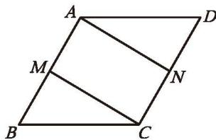

22. 如图，点 M，N 分别在 □ABCD 的边 AB 和 CD 上。

(1) 已知 $AM = \frac{1}{2} AB, CN = \frac{1}{2} CD$ , 求证: 四边形 $AMCN$ 是平行四边形;

(第22题)

(2) 当 $AM = \frac{1}{3} AB$ ， $CN = \frac{1}{3} CD$ 时，四边形 AMCN 是平行四边形吗？如果 $AM = \frac{1}{m} AB$ ，

$$
C N = \frac {1}{m} C D (m > 1) \text {呢?}
$$

你能得出一个一般性的结论吗？试一试！
