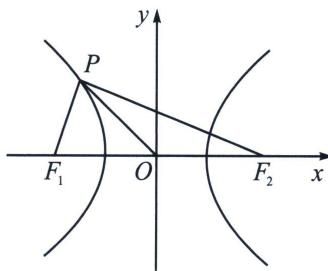

例8（2024·德阳模拟）设 $F_{1}$ 、 $F_{2}$ 是双曲线 $C: \frac{x^{2}}{a^{2}} - \frac{y^{2}}{b^{2}} = 1 (a > 0, b > 0)$ 的左、右焦点， $O$ 是坐标原点，点 $P$ 是 $C$ 上异于实轴端点的任意一点，若 $|PF_{1}| \cdot |PF_{2}| - |OP|^{2} = 2a^{2}$ ，则 $C$ 的离心率为（）
A. $\sqrt{3}$ B. $\sqrt{2}$ C. 3
D. 2

## 相关知识点

暂无已审核的相关知识点。

> 来源：2026版高中《mst老唐说题》圆锥曲线专题（数学）
