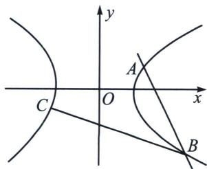
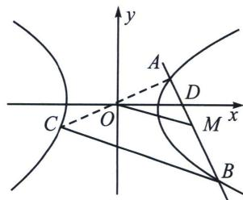

例6 (2024·三台县模拟)如图, 已知斜率为 $-2$ 的直线与双曲线 $\frac{x^{2}}{a^{2}} - \frac{y^{2}}{b^{2}} = 1 (a > 0, b > 0)$ 的右支交于 $A, B$ 两点, 点 $A$ 关于坐标原点 $O$ 对称的点为 $C$ , 且 $\angle ABC = 45^{\circ}$ , 则该双曲线的离心率为 \_\_\_\_.

## 相关知识点

暂无已审核的相关知识点。

> 来源：2026版高中《mst老唐说题》圆锥曲线专题（数学）
