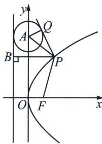

例9 (2024·多选·新课标Ⅱ卷)抛物线 C: $y^{2}=4x$ 的准线为 l, P 为 C 上的动点，过 P 作 $\odot A: x^{2}+(y-4)^{2}=1$ 的一条切线，Q 为切点，过 P 作 l 的垂线，垂足为 B，则
A. l 与 $\odot A$ 相切
B. 当 P, A, B 三点共线时， $|PQ|=\sqrt{15}$ C. 当 $|PB|=2$ 时， $PA\perp AB$ D. 满足 $|PA|=|PB|$ 的点 P 有且仅有 2 个

