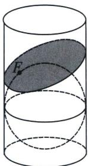
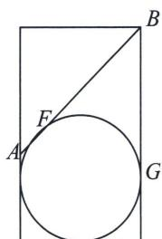

例8 (2023·广东期末)圆锥曲线与空间几何体具有深刻而广泛的联系。如图所示, 底面半径为 1 , 高为 3 的圆柱内放有一个半径为 1 的球, 球与圆柱下底面相切, 作不与圆柱底面平行的平面 $\alpha$ 与球相切于点 $F$ , 若平面 $\alpha$ 与圆柱侧面相交所得曲线为封闭曲线 $\tau$ , $\tau$ 是以 $F$ 为一个焦点的椭圆, 则 $\tau$ 的离心率的取值范围是 ( )

A. $\left[\frac{3}{5}, 1\right)$ B. $(0, \frac{3}{5}]$ C. $(0, \frac{4}{5}]$ D. $\left[\frac{4}{5}, 1\right)$

