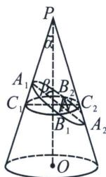
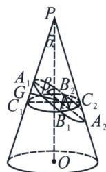

例13（2024·信阳模拟）如图，已知圆锥 $PO$ 的轴 $PO$ 与母线所成的角为 $\alpha$ ，过 $A$ 的平面与圆锥的轴所成的角为 $\beta$ ，该平面截这个圆锥所得的截面为椭圆 $C$ ，椭圆 $C$ 的长轴为 $A_{1}A_{2}$ ，短轴为 $B_{1}B_{2}$ ，长半轴长为 3， $C$ 的中心为 $N$ ，再以 $B_{1}B_{2}$ 为弦且垂直于 $PO$ 的圆截面，记该圆与直线 $PA_{1}$ 交于 $C_{1}$ ，与直线 $PA_{2}$ 交于 $C_{2}$ ，设 $\cos \alpha = 3\cos \beta$ .

(1)求椭圆 C 的焦距;

(2)椭圆 C 左右焦点分别为 $F_{1}$ ， $F_{2}$ ，C 上不同两点 A，B，满足 $\overrightarrow{F_{1}A} = \lambda \overrightarrow{F_{2}B} (\lambda > 0)$ ，设直线 $F_{1}B$ ， $F_{2}A$ 交于点 Q， $S_{\triangle QAB} = 1$ ，求四边形 $ABF_{2}F_{1}$ 的面积.

## 相关知识点

暂无已审核的相关知识点。

> 来源：2026版高中《mst老唐说题》圆锥曲线专题（数学）
