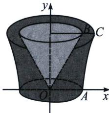

例16（2024·盐城期末）祖暅，祖冲之之子，他的“祖暅原理”：幂势既同，则积不容异．意思是：夹在两个平行平面之间的两个几何体，被平行于这两个平面的任意平面所截，如果截得的面积总相等，那么这两个几何体的体积相等．将双曲线 $E: \frac{x^2}{9} - \frac{y^2}{25} = 1$ 与 $y = 0$ ， $y = 5$ 所围成的平面图形（含边界）绕其虚轴旋转一周得到如图所示的几何体 $\Gamma$ ，其中线段 $OA$ 为双曲线的实半轴，直线 $y = 5$ 分别与双曲线 $E$ 的一条渐近线及右支交于点 $B$ 和 $C$ ，则线段 $BC$ 旋转一周所得图形的面积为 \_\_\_\_ ，几何体 $\Gamma$ 的体积为 \_\_\_\_.

## 相关知识点

暂无已审核的相关知识点。

> 来源：2026版高中《mst老唐说题》圆锥曲线专题（数学）
