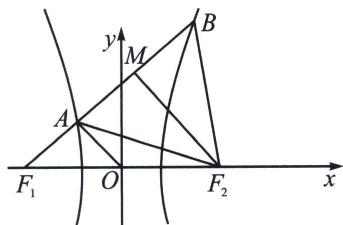

例24（2024·多选·南关区模拟）已知 $F_{1}$ , $F_{2}$ 分别为双曲线的左、右焦点, 过 $F_{1}$ 的直线交双曲线左、右两支于 $A$ , $B$ 两点, 若 $\triangle ABF_{2}$ 为等腰直角三角形, 则双曲线的离心率可以为 ( )
A. $\sqrt{6}+\sqrt{3}$ B. $\sqrt{3}$ C. $\sqrt{5+2\sqrt{2}}$ D. $\sqrt{5-2\sqrt{2}}$

