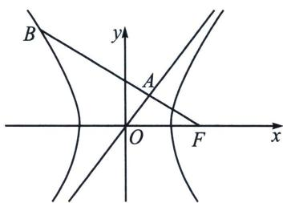

例4 (2024·厦门模拟)已知双曲线 $C: \frac{x^{2}}{a^{2}} - \frac{y^{2}}{b^{2}} = 1 (a > 0, b > 0)$ , 过右焦点 $F$ 作一条渐近线的垂线, 垂足为 $A$ , 点 $B$ 在 $C$ 上, 且 $\overrightarrow{FB} = 4\overrightarrow{FA}$ , 则 $C$ 的离心率为 $\frac{3\sqrt{2}}{2}$ B. $\frac{5}{3}$ C. 2 D. 3

