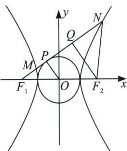
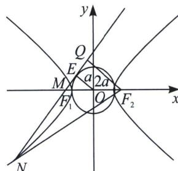

例6 (2022·多选·乙卷)双曲线 $C$ 的两个焦点为 $F_{1}, F_{2}$ , 以 $C$ 的实轴为直径的圆记为 $D$ , 过 $F_{1}$ 作 $D$ 的切线与 $C$ 交于 $M, N$ 两点, 且 $\cos \angle F_{1}NF_{2} = \frac{3}{5}$ , 则 $C$ 的离心率为 ( )
A. $\frac{\sqrt{5}}{2}$ B. $\frac{3}{2}$ C. $\frac{\sqrt{13}}{2}$ D. $\frac{\sqrt{17}}{2}$

## 相关知识点

暂无已审核的相关知识点。

> 来源：2026版高中《mst老唐说题》圆锥曲线专题（数学）
