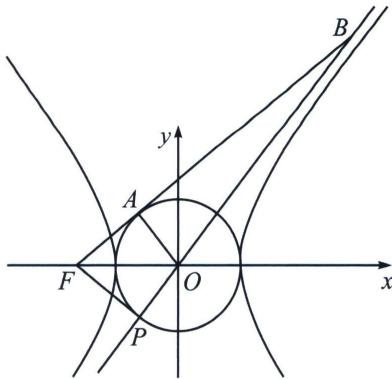

例9 (2024·化州市期中)过双曲线 $C: \frac{x^2}{a^2} - \frac{y^2}{b^2} = 1 (a > 0, b > 0)$ 的左焦点 $F$ 作圆 $x^2 + y^2 = a^2$ 的切线，

切点为 A，直线 FA 交直线 bx - ay = 0 于点 B。若 $\overrightarrow{BA} = 3\overrightarrow{AF}$ ，则双曲线 C 的离心率为 \_\_\_\_.

