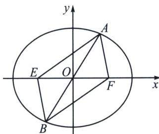

例4 (2023·浙江模拟)已知椭圆 $C: \frac{x^{2}}{a^{2}} + \frac{y^{2}}{b^{2}} = 1 (a > b > 0)$ 的右焦点为 $F$ , 过坐标原点 $O$ 的直线 $l$ 与椭圆 $C$ 交于 $A, B$ 两点. 在 $\triangle AFB$ 中, $\angle AFB = 120^{\circ}$ , 且满足 $S_{\triangle AFB} \geqslant \frac{1}{2} ac$ , 则椭圆 $C$ 的离心率 $e$ 的取值范围为 \_\_\_\_.

