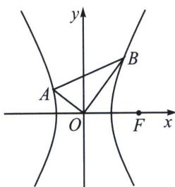

例17 (2024·聊城三模)已知双曲线 $C: \frac{x^{2}}{a^{2}} - \frac{y^{2}}{b^{2}} = 1 (b > a > 0)$ 的一个焦点为 $F, O$ 为坐标原点，点 $A, B$ 在双曲线上运动，以 $A, B$ 为直径的圆过点 $O$ ，且 $|\overrightarrow{OA} + \overrightarrow{OB}| |\overrightarrow{OF}| \leqslant |\overrightarrow{OA}||\overrightarrow{OB}|$ 恒成立，则 $C$ 的离心率的取值范围为 \_\_\_\_.

