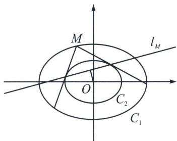

例4（黑龙江省大庆实验中学实验2024—2025学年高三下学期得分训练(二)T14）已知 $a > b > 0$ ，从椭圆 $C: \frac{x^2}{a^2} + \frac{y^2}{b^2} = 1$ 外一点 $P(x_0, y_0)$ 向椭圆引两条切线，切点分别为 $A, B$ ，则直线 $AB$ 方程为 $\frac{x_0x}{a^2} + \frac{y_0y}{b^2} = 1$ 称为点 $P$ 关于椭圆 $C$ 的极线．如图，两个椭圆 $C_1, C_2$ 的方程分别为 $\frac{x^2}{a^2} + \frac{y^2}{b^2} = 1 (a > b > 0)$ 和 $\frac{x^2}{m^2} + \frac{y^2}{n^2} =$

$1 (m > n > 0)$ , 离心率分别为 $e_1$ 、 $e_2$ , $C_2$ 在 $C_1$ 内, 椭圆 $C_1$ 上的任意一点 $M$ 关于椭圆 $C_2$ 的极线为 $l_M$ . 若 $O$ 到 $l_M$ 的距离为定值 1, 则 $e_1^2 - e_2^2$ 取最大值时 $e_2$ 的值为 \_\_\_\_.

