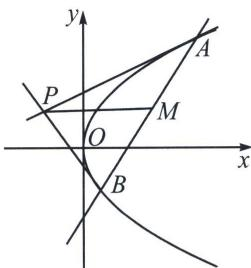

例12 (2025·山西·三模)已知过点 $M(2, 1)$ 的直线交抛物线 $C: y^{2} = 4x$ 于 $A, B$ 两点，过点 $A, B$ 分别作抛物线 $C$ 的切线，两条切线交于点 $P$ ，则 $|PM|$ 的最小值为（）
A. $\frac{7\sqrt{5}}{5}$ B. $\sqrt{5}$ C. $\sqrt{2}$ D. $\frac{15\sqrt{17}}{17}$

## 相关知识点

暂无已审核的相关知识点。

> 来源：2026版高中《mst老唐说题》圆锥曲线专题（数学）
