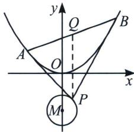

例15（2021·全国乙卷）已知抛物线 $C: x^{2} = 2py (p > 0)$ 的焦点为 $F$ ，且 $F$ 与圆 $M: x^{2} + (y + 4)^{2} = 1$ 上点的距离的最小值为 4.

(1)求 $p$ ;

(2)若点 $P$ 在 $M$ 上, $PA$ , $PB$ 为 $C$ 的两条切线, $A$ , $B$ 是切点, 求 $\triangle PAB$ 面积的最大值.

