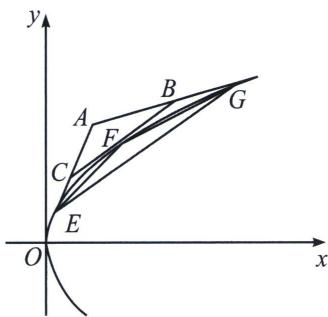
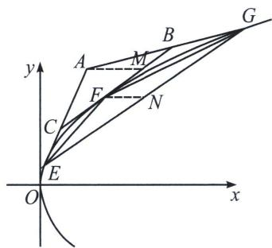

例19 (2024·深圳市期末)给出如下的定义和定理:

定义：若直线 l 与抛物线 $\Gamma$ 有且仅有一个公共点 P，且 l 与 $\Gamma$ 的对称轴不平行，则称直线 l 与抛物线 $\Gamma$ 相切，公共点 P 称为切点.

定理：过抛物线 $y^{2}=2px$ 上一点 $(x_{0}, y_{0})$ 处的切线方程为 $y_{0}y=px_{0}+px$ .

完成下述问题:

如图所示, 设 $E 、 F$ 是抛物线 $\Gamma: y^{2} = 2px (p > 0)$ 上两点. 过点 $E 、 F$ 分别作抛物线 $\Gamma$ 的两条切线 $l_{1} 、 l_{2}$ , 直线 $l_{1} 、 l_{2}$ 交于点 $C$ , 点 $A 、 B$ 分别在线段 $E C 、 C F$ 的延长线上, 且满足 $\overrightarrow{E C} = \lambda \overrightarrow{C A}, \overrightarrow{C F} = \lambda \overrightarrow{F B}$ , 其中 $\lambda > 0$ .

(1)若点 E、F 的纵坐标分别为 $y_{1}$ 、 $y_{2}$ ，用 $y_{1}$ 、 $y_{2}$ 和 p 表示点 C 的坐标；

(2)证明：直线 $AB$ 与抛物线 $\Gamma$ 相切；

(3)设直线 $AB$ 与抛物线 $\Gamma$ 相切于点 $G$ ，求 $\frac{S_{\triangle EFG}}{S_{\triangle ABC}}.$

