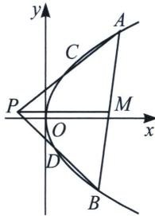

例6 (2021·浙江卷)如图, 已知点 $P$ 是 $y$ 轴左侧 (不含 $y$ 轴) 一点, 抛物线 $E: y^{2} = 4x$ 上存在不同的两点 $A, B$ 满足 $PA, PB$ 的中点均在 $E$ 上.

(1)设 $AB$ 中点为 $M$ , 证明: $PM$ 垂直于 $y$ 轴;

(2) 若 $P$ 是半椭圆 $x^{2} + \frac{y^{2}}{4} = 1 (x < 0)$ 上的动点, 求 $\triangle PAB$ 面积的取值范围.

## 相关知识点

暂无已审核的相关知识点。

> 来源：2026版高中《mst老唐说题》圆锥曲线专题（数学）
