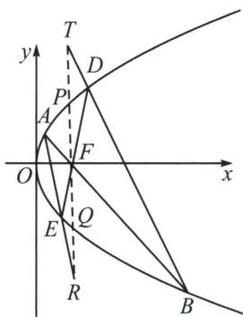

例7 (2025 苏州大学考前适应卷第 18 题(陪跑课学员汪小云提问))在平面直角坐标系 $xOy$ 中, 已知抛

物线 $\Gamma: y^{2}=4x$ 的焦点为 F，直线 $l_{1}$ 与 $\Gamma$ 交于 A，B 两点.

(1) 若 $l_{1}$ 过 F，另一条过 F 的直线 $l_{2}$ 与 $\Gamma$ 交于 D，E 两点 (A, D 在 x 轴上方)，直线 AE，BD 分别交直线 x = 1 于 R，T 两点，证明：F 为 RT 的中点；

(2) 若 $\Gamma$ 上存在点 $C$ , 使得 $\overrightarrow{FA} \cdot \overrightarrow{BC} = \overrightarrow{FB} \cdot \overrightarrow{AC} = 0$ , 证明: $\overrightarrow{FA} \cdot \overrightarrow{FB}$ 为定值.

