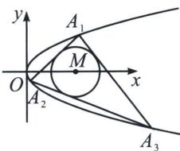

例12 (2021·全国甲卷)抛物线 $C$ 的顶点为坐标原点 $O$ , 焦点在 $x$ 轴上, 直线 $l: x = 1$ 交 $C$ 于 $P 、 Q$ 两点, 且 $OP \perp OQ$ , 已知点 $M(2,0)$ , 且圆 $M$ 与 $l$ 相切.

(1)求 C，圆 M 的方程；

(2)设 $A_{1}$ 、 $A_{2}$ 、 $A_{3}$ 是 $C$ 上的三个点，直线 $A_{1}A_{2}$ ， $A_{1}A_{3}$ 均与圆 $M$ 相切，判断直线 $A_{2}A_{3}$ 与圆 $M$ 的位置关系，并说明理由.

