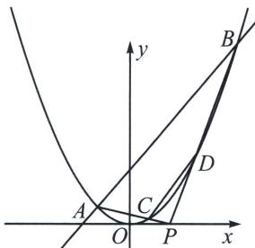

例14 (2024·浙江模拟)如图所示, 已知抛物线 $x^{2} = 4y$ 的焦点为 $F$ , 过 $F$ 的直线交抛物线于 $A$ , $B$ 两
B 老唐说题

点，A 在 y 轴左侧且 AB 的斜率大于 0.

(1)当直线 $AB$ 的斜率为 1 时, 求弦长 $|AB|$ 的长度;

(2) 点 $P(x_0, 0)$ 在 $x$ 轴正半轴上，连接 $PA, PB$ 分别交抛物线于 $C, D$ 若 $AB \parallel CD$ 且 $|AB| = 3|CD|$ ，求 $x_0$ .

