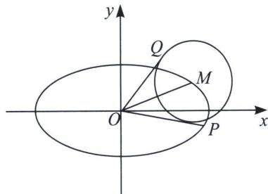

例7 (2021·浙江模拟)如图, 在平面直角坐标系 $xOy$ 中, 设点 $M(x_0, y_0)$ 是椭圆 $C: \frac{x^2}{16} + \frac{y^2}{4} = 1$ 上一点, 从原点 $O$ 向圆 $M: (x - x_0)^2 + (y - y_0)^2 = r^2$ 作两条切线, 分别与椭圆 $C$ 交于点 $P$ , $Q$ , 直线 $OP$ , $OQ$ 的斜率分别记为 $k_1$ , $k_2$ .

(1) 若圆 M 与 x 轴相切于椭圆 C 的右焦点，求圆 M 的方程；

(2) 若 $r=\frac{4\sqrt{5}}{5}$ ，求证： $k_{1}k_{2}=-\frac{1}{4}$ ;

(3)在(2)的情况下，求 $|OP|\cdot|OQ|$ 的最大值.

