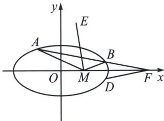

例⑪ (2025·南昌一模 T18)已知椭圆 $C: \frac{x^{2}}{a^{2}} + \frac{y^{2}}{b^{2}} = 1 (a > b > 0)$ 的离心率 $e = \frac{\sqrt{3}}{2}$ , 过点 $P(4, 0)$ 作直线 $l$ 与椭圆 $C$ 交于 $A$ , $B$ 两点 ( $A$ 在 $B$ 上方), 当 $l$ 的斜率为 $-\frac{1}{4}$ 时, 点 $A$ 恰与椭圆的上顶点重合.

(1)求椭圆 C 的标准方程;

(2)已知 $M(1,0)$ ，设直线 MA，MB 的斜率分别为 $k_{1}$ ， $k_{2}$ ，设 $\triangle AMB$ 的外接圆圆心为 E。点 B 关于 x 轴的对称点为 D。

(i) 求 $k_{1} + k_{2}$ 的值；

(ii) 求证: $ME \perp PD$ .

