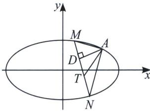

例2 (2020·山东)已知椭圆 $C: \frac{x^2}{a^2} + \frac{y^2}{b^2} = 1 (a > b > 0)$ 的离心率为 $\frac{\sqrt{2}}{2}$ , 且过点 $A(2, 1)$ .

(1)求 C 的方程;

(2)点 $M, N$ 在 $C$ 上，且 $AM \perp AN, AD \perp MN, D$ 为垂足．证明：存在定点 $Q$ ，使得 $|DQ|$ 为定值.

## 相关知识点

暂无已审核的相关知识点。

> 来源：2026版高中《mst老唐说题》圆锥曲线专题（数学）
