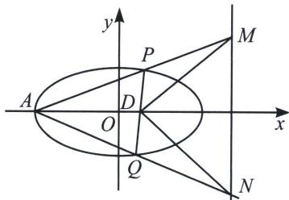

例①（武汉市2021届高中毕业生三月质量检测）已知椭圆 $C: \frac{x^{2}}{a^{2}} + \frac{y^{2}}{b^{2}} = 1 (a > b > 0)$ 的左右顶点分别为 $A, B$ , 过椭圆内点 $D\left(\frac{2}{3}, 0\right)$ 且不与 $x$ 轴重合的动直线交椭圆 $C$ 于 $P$ , $Q$ 两点, 当直线 $PQ$ 与 $x$ 轴垂直时, 239 老唐说题

$|PD|=|BD|=\frac{4}{3}.$

(1)求椭圆 C 的标准方程;

(2)设直线 $AP$ ， $AQ$ 和直线 $l: x = t$ 分别交于点 $M$ ， $N$ ，若 $MD \perp ND$ 恒成立，求 $t$ 的值.

## 相关知识点

暂无已审核的相关知识点。

> 来源：2026版高中《mst老唐说题》圆锥曲线专题（数学）
