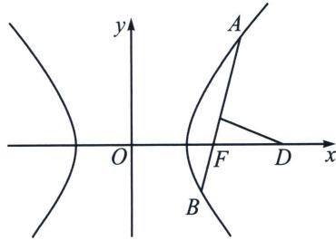

例8 (2024·广东模拟)已知双曲线 $\frac{x^{2}}{a^{2}}-\frac{y^{2}}{b^{2}}=1(a>0,b>0)$ 的右焦点为F，过点F且斜率为 $k(k\neq0)$ 的直线l交双曲线于A、B两点，线段AB的中垂线交x轴于点D．若 $|AB|\geqslant\sqrt{3}|DF|$ ，则双曲线的离心率取值范围是( )

A. $\left(1,\frac{2\sqrt{3}}{3}\right]$ B. $(1,\sqrt{3}]$ C. $[\sqrt{3},+\infty)$ D. $\left[\frac{2\sqrt{3}}{3},+\infty\right)$

