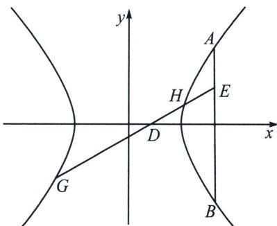

例3 (2023·四省联考)已知双曲线 $C: \frac{x^{2}}{a^{2}} - \frac{y^{2}}{b^{2}} = 1 (a > 0, b > 0)$ 过点 $A(4\sqrt{2}, 3)$ , 且焦距为 10.

(1)求 C 的方程;

(2)已知点 $B(4\sqrt{2}, -3)$ , $D(2\sqrt{2}, 0)$ , $E$ 为线段 $AB$ 上一点, 且直线 $DE$ 交 $C$ 于 $G$ , $H$ 两点. 证明: $\frac{|GD|}{|GE|} = \frac{|HD|}{|HE|}$ .

##

## 相关知识点

暂无已审核的相关知识点。

> 来源：2026版高中《mst老唐说题》圆锥曲线专题（数学）
