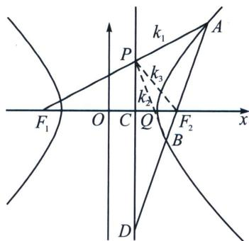

例9 (24 武汉二调)已知双曲线 $E: \frac{x^{2}}{a^{2}} - \frac{y^{2}}{b^{2}} = 1$ 的左右焦点为 $F_{1}, F_{2}$ , 其右准线为 $l$ , 点 $F_{2}$ 到直线 $l$ 的距离为 $\frac{3}{2}$ , 过点 $F_{2}$ 的动直线交双曲线 $E$ 于 $A, B$ 两点, 当直线 $AB$ 与 $x$ 轴垂直时, $|AB| = 6$ .

(1)求双曲线 E 的标准方程;

(2)设直线 $AF_{1}$ 与直线 l 的交点为 P，证明：直线 PB 过定点.

