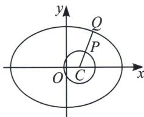

例4 (2023·河南模拟)设 $P, Q$ 分别为圆 $(x - 1)^{2} + y^{2} = 2$ 和椭圆 $\frac{x^{2}}{25} + \frac{y^{2}}{16} = 1$ 上的点, 则 $P, Q$ 两点间的最短距离是 ( ) A. $\sqrt{2}$ B. $\frac{5\sqrt{2}}{3}$ C. $\frac{8\sqrt{2}}{3}$ D. $\frac{11\sqrt{2}}{3}$

