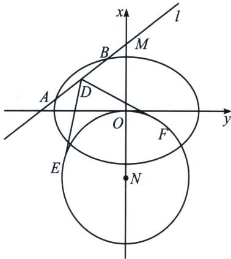

例6 (2017·山东)在平面直角坐标系 $xOy$ 中, 已知椭圆 $C: \frac{x^2}{a^2} + \frac{y^2}{b^2} = 1 (a > b > 0)$ 的离心率为 $\frac{\sqrt{2}}{2}$ , 椭圆 $C$ 截直线 $y = 1$ 所得线段的长度为 $2\sqrt{2}$ .

(1)求椭圆 C 的方程;

(2)动直线 $l: y = kx + m (m \neq 0)$ 交椭圆 $C$ 于 $A, B$ 两点，交 $y$ 轴于点 $M$ 。点 $N$ 是 $M$ 关于 $O$ 的对称点， $\odot N$ 的半径为 $|NO|$ 。设 $D$ 为 $AB$ 的中点， $DE, DF$ 与 $\odot N$ 分别相切于点 $E, F$ ，求 $\angle EDF$ 的最小值。

