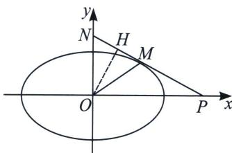

例10（2022·天津卷）椭圆 $\frac{x^{2}}{a^{2}}+\frac{y^{2}}{b^{2}}=1(a>b>0)$ 离心率为 $\frac{\sqrt{6}}{3}$ ，直线l与椭圆有唯一公共点M，与y轴交于点N(N异于M)，记O为原点，若 $|OM|=|ON|$ ，且 $\triangle OMN$ 面积为 $\sqrt{3}$ ，求椭圆方程.

## 相关知识点

暂无已审核的相关知识点。

> 来源：2026版高中《mst老唐说题》圆锥曲线专题（数学）
