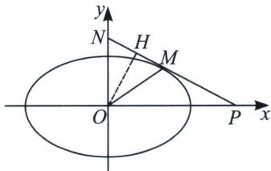

例6 (2022·天津卷)椭圆 $\frac{x^2}{a^2} +\frac{y^2}{b^2} = 1(a > b > 0)$ 离心率为 $\frac{\sqrt{6}}{3}$ , 直线 $l$ 与椭圆有唯一公共点 $M$ , 与 $y$ 轴交于点 $N(N$ 异于 $M$ ), 记 $O$ 为原点, 若 $|OM| = |ON|$ , 且 $\triangle OMN$ 面积为 $\sqrt{3}$ , 求椭圆方程.

