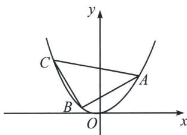

例10（2022·德州三模）已知 F 为抛物线 $\Gamma: x^{2}=2py(p>0)$ 的焦点，点 P 在抛物线 $\Gamma$ 上，O 为坐标原点， $\triangle OPF$ 的外接圆与抛物线 $\Gamma$ 的准线相切，且该圆周长为 $3\pi$ .

(1)求抛物线 $\Gamma$ 的方程;

(2)如图, 设点 $A, B, C$ 都在抛物线 $\Gamma$ 上, 若 $\triangle ABC$ 是以 $AC$ 为斜边的等腰直角三角形, 求 $\overrightarrow{AB} \cdot \overrightarrow{AC}$ 的最小值.

## 相关知识点

暂无已审核的相关知识点。

> 来源：2026版高中《mst老唐说题》圆锥曲线专题（数学）
