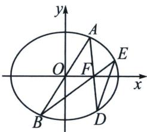

例5 (2023·江苏月考)在平面直角坐标系 $xOy$ 中, 椭圆 $C: \frac{x^2}{a^2} + \frac{y^2}{b^2} = 1 (a > b > 0)$ 的离心率是 $\frac{1}{2}$ , 焦点到相应准线的距离是 3.

(1) 求 $a, b$ 的值；

(2)已知 $A 、 B$ 是椭圆 $C$ 上关于原点对称的两点, $A$ 在 $x$ 轴的上方, $F(1,0)$ , 连接 $A F 、 B F$ 并分别延长交椭圆 $C$ 于 $D 、 E$ 两点, 证明: 直线 $D E$ 过定点.

