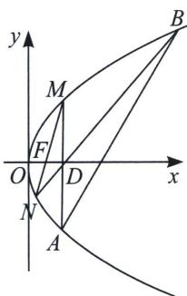
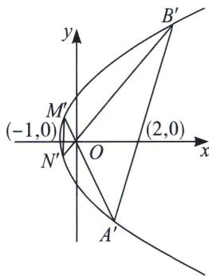

例6（2022·全国甲卷）已知抛物线 C: $y^{2}=2px(p>0)$ 焦点为 F，点 D(p,0) 过焦点 F 做直线 l 交抛物线于 M, N 两点，当 $MD \perp x$ 轴时， $|MF|=3$ .

(1)求抛物线方程，

(2)若直线 $MD, ND$ 与抛物线的另一个交点分别为 $A, B$ . 若直线 $MN, AB$ 的倾斜角为 $\alpha, \beta$ , 当 $\alpha - \beta$ 最大时, 求 $AB$ 的方程.

