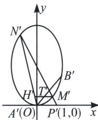

例9 (2022·全国乙卷)已知椭圆 E 的中心为坐标原点，对称轴为 x 轴、y 轴，且过 A(0, -2)，B $\left(\frac{3}{2}, -1\right)$ 两点.

(1)求 $E$ 的方程;

(2)设过点 $P(1, -2)$ 的直线交 $E$ 于 $M, N$ 两点, 过 $M$ 且平行于 $x$ 轴的直线与线段 $A B$ 交于点 $T$ , 点 $H$ 满足 $\overrightarrow{M T} = \overrightarrow{T H}$ . 证明: 直线 $H N$ 过定点.

