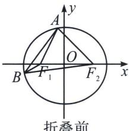
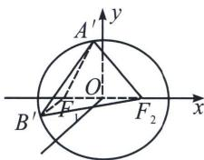

例4 (2024·浙江模拟)已知椭圆 $C: \frac{x^2}{a^2} + \frac{y^2}{b^2} = 1 (a > b > 0)$ 的左、右焦点分别为 $F_1$ 、 $F_2$ ，焦距为 $2\sqrt{3}$ ，离心率为 $\frac{\sqrt{3}}{2}$ ，直线 $l: y = x + m$ 与椭圆交于 $A$ 、 $B$ 两点（其中点 $A$ 在 $x$ 轴上方，点 $B$ 在 $x$ 轴下方）.

(1)求椭圆 C 的标准方程;

(2)如图, 将平面 $xOy$ 沿 $x$ 轴折叠, 使 $y$ 轴正半轴和 $x$ 轴所确定的半平面 (平面 $A^{\prime}F_{1}F_{2}$ ) 与 $y$ 轴负半轴和 $x$ 轴所确定的半平面 (平面 $B^{\prime}F_{1}F_{2}$ ) 垂直.

①若折叠后 $OA' \perp OB'$ ，求 m 的值；

②是否存在 m，使折叠后 $A'$ 、 $B'$ 两点间的距离与折叠前 A、B 两点间的距离之比为 $\frac{3}{4}$ ?

  
折叠前

  
折叠后

