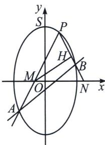
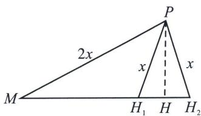
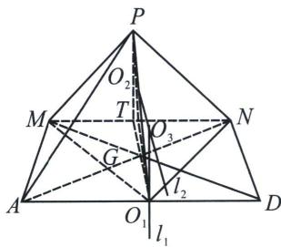

例5 (2025·成都外国语联盟模拟19题)在平面直角坐标系中, 分别以 $x$ 轴和 $y$ 轴为实轴和虚轴建立复平面. 已知复数 $z = x + yi(x, y \in \mathbb{R})$ , 在复平面内满足 $|z + 2i| + |z - 2i|$ 为定值的点 $Z$ 的轨迹为曲线 $\Gamma$ . 且点 $P(1, \sqrt{3})$ 在曲线 $\Gamma$ 上.

(1)求曲线 $\Gamma$ 的平面直角坐标系方程;

(2)若斜率为 $\sqrt{3}$ 的直线 $l$ 与曲线 $\Gamma$ 交于 $A 、 B$ 两点 (直线 $P A$ 斜率为正), 直线 $P A 、 P B$ (若 $P 、 B$ 重合,

直线 $PB$ 即为椭圆 $\Gamma$ 在 $P$ 点处的切线)分别与 $x$ 轴交于 $M 、 N$ 两点, $H$ 为 $PN$ 中点.

(i) 证明： $k_{PA} + k_{PB}$ 为定值；

(ii) $\angle PMH$ 最大时, 将坐标平面沿 $x$ 轴折成二面角 $P - MN - A$ , 在二面角 $P - MN - A$ 大小变化过程中, 求三棱锥 $P - MNA$ 外接球的半径最小时, 三棱锥 $P - MNA$ 的表面积.

