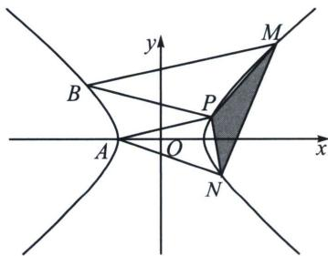
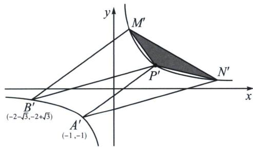

例3 (2024·天一大联考)已知双曲线 C 的中心是坐标原点，对称轴为坐标轴，且过 A(-2, 0)，B(-4, 3)两点.

(1) 求 C 的方程;

(2)设 P, M, N 三点在 C 的右支上， $BM \parallel AP$ ， $AN \parallel BP$ ，证明：

(i) 存在常数 $\lambda$ ，满足 $\overrightarrow{OM} + \overrightarrow{ON} = \lambda \overrightarrow{OP}$ ;

(ii) $\triangle MNP$ 的面积为定值.

## 相关知识点

暂无已审核的相关知识点。

> 来源：2026版高中《mst老唐说题》圆锥曲线专题（数学）
