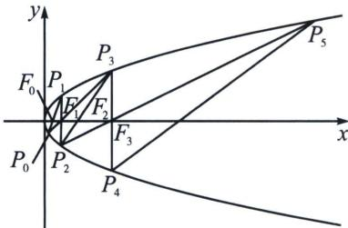
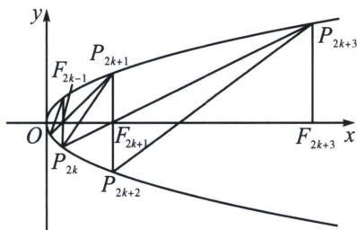

例3（2025·东北三省三校·二模 T19）已知抛物线 C: $y^{2}=4x$ ，焦点为 $F_{0}$ 。抛物线上有一点 $P_{1}(x_{1},y_{1})(x_{1}>1,y_{1}>0)$ ，直线 $F_{0}P_{1}$ 与抛物线的另一个交点为 $P_{0}$ 。按照如下方式依次构造点 $F_{2k-1}$ ， $P_{2k}$ ， $P_{2k+1}$ ， $F_{2k}(k=1,2,3,\cdots)$ ，过 $P_{2k-1}$ 作 x 轴的垂线，垂足为 $F_{2k-1}$ ，垂线与抛物线 C 的另一个交点为 $P_{2k}$ 。作直线 $P_{2k-2}F_{2k-1}$ ，与抛物线 C 的另一个交点为 $P_{2k+1}$ ，直线 $P_{2k}P_{2k+1}$ 与 x 轴的交点为 $F_{2k}$ 。记 $P_{n}(x_{n},y_{n})$ ， $F_{n}(m_{n},0)$ ， $m_{1}=m$ ， $(n=0,1,2,\cdots)$ 。

(1) 若 $P_{1}(2, 2\sqrt{2})$ ，求 $m_{0}, m_{1}, m_{2}, m_{3}$ ;

(2)求证: 数列 $\{m_{n}\}$ 是等比数列, 并用 $m$ 表示数列 $\{m_{n}\}$ 的通项公式;

(3)对任意的正整数 k， $\triangle P_{2k-2}P_{2k-1}F_{2k-1}$ 与 $\triangle F_{2k-1}P_{2k}P_{2k+1}$ 的面积之比是否为定值？若是，请用 m 表示这个定值；若不是，请说明理由.

## 相关知识点

暂无已审核的相关知识点。

> 来源：2026版高中《mst老唐说题》圆锥曲线专题（数学）
