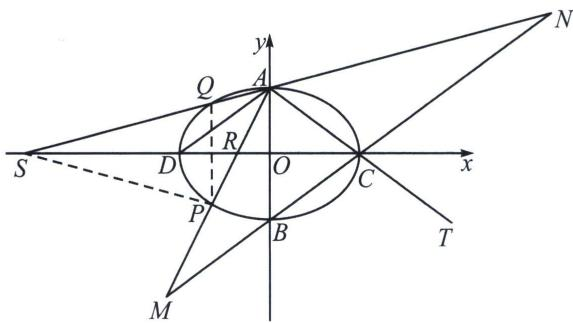

例1 (2025·北京清华附中高三开学)已知椭圆 $E: \frac{x^{2}}{a^{2}} + \frac{y^{2}}{b^{2}} = 1 (a > b > 0)$ , 其离心率 $e = \frac{\sqrt{5}}{3}$ , 长轴长为 6.

(1)求椭圆 E 的标准方程;

(2)椭圆 E 的上、下顶点分别为 A、B，右顶点为 C，过点 A 的直线 l 与椭圆 E 的另一个交点为 P，点 Q 与点 P 关于 x 轴对称，直线 AP 交 BC 于 M，直线 AQ 交 BC 于点 N，点 $T(6, -2)$ ，

求证： $|AM|=|TN|$ .

(2)极点极线背景

