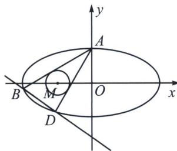

例5 (2025·重庆南坪中学期中第19题)如图, 已知椭圆 $C: \frac{x^{2}}{a^{2}} + \frac{y^{2}}{b^{2}} = 1 (a > b > 0)$ 的上顶点为 $A(0,$

3)，离心率为 $\frac{\sqrt{3}}{2}$ ，若过点A作圆 $M:(x+3)^{2}+y^{2}=r^{2}(0<r<3)$ 的两条切线分别与椭圆C相交于点B，D(不同于点A).

(1)求椭圆 C 的方程;

(2)设直线 AB 和 AD 的斜率分别为 $k_{1}$ ， $k_{2}$ ，求证： $k_{1} \cdot k_{2}$ 为定值；

(3)求证: 直线 $BD$ 过定点.

## 相关知识点

暂无已审核的相关知识点。

> 来源：2026版高中《mst老唐说题》圆锥曲线专题（数学）
