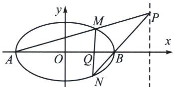

例1 (2020·新课标 I)已知 A, B 分别为椭圆 E: $\frac{x^{2}}{a^{2}} + y^{2} = 1 (a > 1)$ 的左、右顶点, G 为 E 的上顶点, $\overrightarrow{AG} \cdot \overrightarrow{GB} = 8$ . P 为直线 x = 6 上的动点, PA 与 E 的另一交点为 M, PB 与 E 的另一交点为 N.

(1)求 $E$ 的方程;

(2)证明：直线 $MN$ 过定点.

