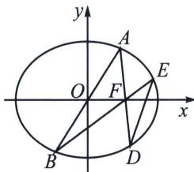
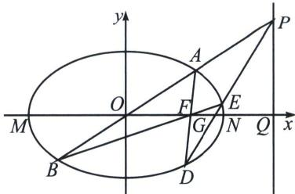

例4 (2023·江苏模拟)在平面直角坐标系 $xOy$ 中, 椭圆 $C: \frac{x^2}{a^2} + \frac{y^2}{b^2} = 1 (a > b > 0)$ 的离心率是 $\frac{1}{2}$ , 焦点到相应准线的距离是 3.

(1) 求 a, b 的值;

(2)已知 A、B 是椭圆 C 上关于原点对称的两点，A 在 x 轴的上方， $F(1,0)$ ，连接 AF、BF 并分别延长交椭圆 C 于 D、E 两点，证明：直线 DE 过定点.

