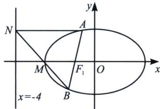

例2 已知椭圆 $C: \frac{x^2}{a^2} + \frac{y^2}{b^2} = 1 (a > b > 0)$ 的左、右焦点分别为 $F_1, F_2$ ，长轴长为 $4\sqrt{2}, A, B$ 为椭圆上的两个动点，当 $A, B$ 关于原点对称时， $(|AF_2| + |BF_2|) \cdot S_{\triangle ABF_2}$ 的最大值为 $16\sqrt{2}$ .

(1)求椭圆 C 的方程;

(2)若存在实数 $\lambda$ 使得 $\overrightarrow{AF_{1}} = \lambda \overrightarrow{AB}$ ，过点 A 作直线 x = -4 的垂线，垂足为 N，直线 NB 是否恒过某点？若恒过某点，求出该点坐标；若不过定点，请说明理由.

