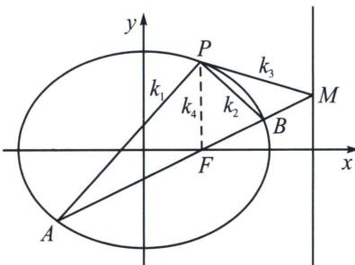

例19（2013·江西理）如图，椭圆 $C: \frac{x^2}{a^2} + \frac{y^2}{b^2} = 1 (a > b > 0)$ 经过点 $P\left(1, \frac{3}{2}\right)$ ，离心率 $e = \frac{1}{2}$ ，直线 $l$ 的方程为 $x = 4$ .

(1)求椭圆 C 的方程;

(2)AB 是经过右焦点 F 的任一弦(不经过点 P)，设直线 AB 与直线 l 相交于点 M，记 PA，PB，PM 的斜率分别为 $k_{1}$ ， $k_{2}$ ， $k_{3}$ 。问：是否存在常数 $\lambda$ ，使得 $k_{1} + k_{2} = tk_{3}$ ？若存在，求 $\lambda$ 的值；若不存在，说明理由。

##

## 相关知识点

暂无已审核的相关知识点。

> 来源：2026版高中《mst老唐说题》圆锥曲线专题（数学）
