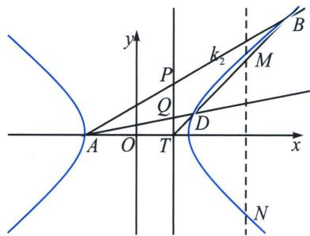

例21（2024·重庆模拟）已知双曲线 $C: \frac{x^2}{a^2} - \frac{y^2}{b^2} = 1 (a, b > 0)$ 的左、右焦点分别为 $F_1, F_2$ ，左顶点为 $A(-2, 0)$ ，点 $M$ 为双曲线上一动点，且 $\left|MF_1\right|^2 + \left|MF_2\right|^2$ 的最小值为 18， $O$ 为坐标原点.

(1)求双曲线 C 的标准方程;

(2)如图, 已知直线 $l: x = m$ 与 $x$ 轴的正半轴交于点 $T$ , 过点 $T$ 的直线交双曲线 $C$ 右支于点 $B, D$ , 直线 ▶ 老唐说题

AB, AD 分别交直线 l 于点 P, Q, 若 O, A, P, Q 四点共圆，求实数 m 的值.

##

## 相关知识点

暂无已审核的相关知识点。

> 来源：2026版高中《mst老唐说题》圆锥曲线专题（数学）
