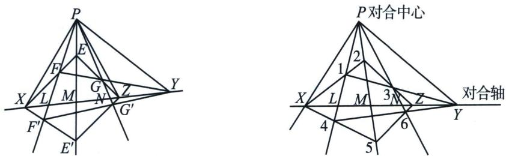

例①（2024·江苏省四校联合）交比是射影几何中最基本的不变量，在欧氏几何中亦有应用。若 $l_{1}, l_{2}, l_{3}, l_{4}$ 为平面上过定点 $P$ 且互异的四条直线， $L_{1}, L_{2}$ 为不过点 $P$ 且互异的两条直线，证明：若 $\triangle EFG$ 与 $\triangle E'F'G'$ 的对应边不平行，对应顶点的连线交于同一点，则 $\triangle EFG$ 与 $\triangle E'F'G'$ 对应边的交点在一条直线上。

## 相关知识点

暂无已审核的相关知识点。

> 来源：2026版高中《mst老唐说题》圆锥曲线专题（数学）
