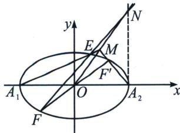
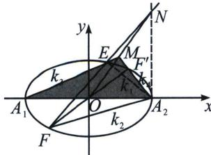

例4 (2024·北京信息卷)已知椭圆 $C: \frac{x^2}{a^2} + \frac{y^2}{b^2} = 1 (a > b > 0)$ 的离心率 $e = \frac{2\sqrt{2}}{3}$ , 且过点 $P(\sqrt{6}, \frac{\sqrt{3}}{3})$ .

(1)求椭圆 C 的方程;

(2)设 $A_{1}$ , $A_{2}$ 为椭圆 $C$ 的左. 右顶点, 不过原点的直线 $l$ 与椭圆 $C$ 交于 $E$ , $F$ 两点, 点 $F$ 关于原点 $O$ 的

对称点为 $F'$ , 直线 $A_{1} E$ 与直线 $A_{2} F'$ 交于点 $M$ , 求证: 直线 $O M$ 与直线 $E F$ 的交点 $N$ 在定直线上.

