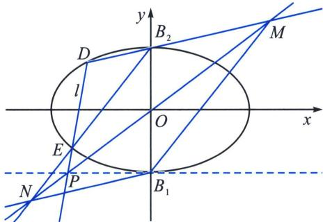

例6（2024·沈阳模拟）已知如图，点 $B_{1}$ ， $B_{2}$ 为椭圆 $C$ 的短轴的两个端点，且 $B_{2}$ 的坐标为 $(0, 1)$ ，椭圆 $C$ 的离心率为 $\frac{\sqrt{2}}{2}$ .

(1)求椭圆 C 的标准方程;

(2)若直线 l 不经过椭圆 C 的中心，且分别交椭圆 C 与直线 y = -1 于不同的三点 D, E, P (点 E 在线段 DP 上)，直线 PO 分别交直线 $DB_{2}$ ， $EB_{2}$ 于点 M, N. 求证：四边形 $B_{1}MB_{2}N$ 为平行四边形.

